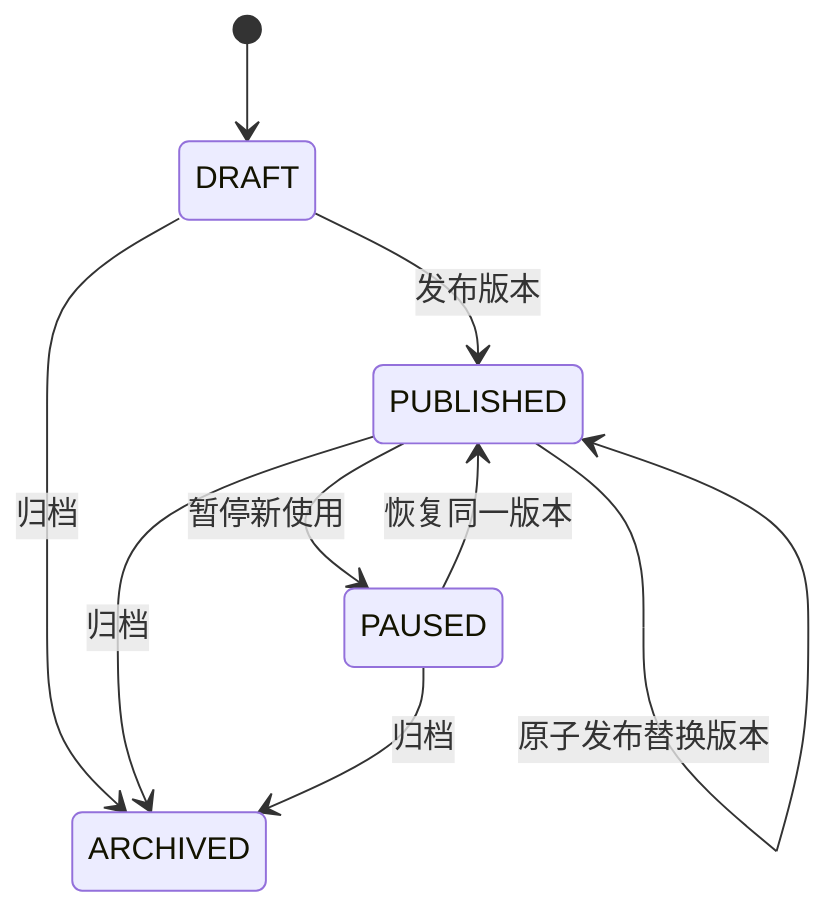

# 统一促销引擎开发设计

需求ID：yudao-member-mall-trade-migration · 设计版本 promotion-v1 · 2026-10-25（Asia/Shanghai）
责任：code-software-engineer。源码基线：20ec7bd1b9de1d4d8665093009d08846997645c2，分支 feat/yudao-member-mall-trade-migration。

**状态：设计交付，未实现运行时引擎。** 本目录的拟新增路径、接口、表及配置均不代表已存在或已执行。算例/Schema校验不是Java实现、数据库集成或生产验收。现有392项后端、169项React、69项小程序测试为基线历史结果，不是本设计的实现证据。

输入：用户同意先统一促销设计与契约，再实现核心购买闭环；仓库AGENTS.md、现有计价/结算/Outbox/退款源码、docs/cached-settlement-api.md与storefront-marketing-api.md。结构参考已读取的 code-software-engineer/references/development-design.md、api-documentation.md、java.md。原型输入：既有结算及优惠券页面，无新的促销配置原型；UI字段映射见下文，正式UI实现前补充对应交互基线。没有复制芋道全量营销实现，也不声称规则与其完全一致。

## 1. 已核实的现状与设计约束

| 实际源码 | 现状 | 影响 |
| --- | --- | --- |
| trade-domain/.../checkout/model/CheckoutRules.java | BigDecimal元计价，至多一张券；满减/支付百分比；折扣向下舍入到分 | legacy coupon适配须逐分等价，不悄悄改成“应付向下舍入” |
| trade-domain/.../model/TradeOrderItem.java | unitPrice/lineAmount为原始行价，无行级优惠字段 | 保留原字段，另存实付/分摊，不把原价覆盖为折后价 |
| trade-application/.../checkout/service/OrderPlacementService.java | prepareSettlement缓存报价；submitSettlement从缓存取快照，重新检查价格/券；首个订单RESERVING | V2继续从缓存生成订单；重新校验不能改成提单时另算并静默改价 |
| trade-infrastructure/.../checkout/gateway/SettlementGatewayImpl.java | Redis key trade:settlement:v1:<id>，NX+TTL；现用JVM Instant.now | V2独立缓存格式/前缀，数据库时间决定有效性；V1不改写 |
| trade V4/V6/V7 SQL | 会员请求幂等、结算绑定、终止栅栏；购物车版本消费保护 | 跨协议复用请求唯一约束与终止栅栏，不另开可重复下单通道 |
| PaymentNotifyCmdExe / CheckoutLifecycleService / TradeOrderCloseCmdExe | 支付/关闭与优惠券use/release同一交易库事务；库存经Outbox | 活动占用也在同一事务确认/释放，不能仅靠Redis过期释放 |
| OrderFulfillmentService | 只有支付前置核验及全额退款REQUESTED/REJECTED，无渠道退款执行 | 退款申请绝不返券/退次数；部分退款仅预留分摊依据 |
| mall-client/.../ProductSnapshotDTO.java | 只有SKU、编码、名称、元价格、库存，无SPU事实 | SPU范围需新增版本化RPC事实；不能由小程序传SPU关系 |
| trade V8 / StorefrontService | 公开领券默认关闭；发券有额度及每人唯一；加购幂等 | 发券额度不等于活动使用次数，不能结算时重复扣发券额度 |

表中省略号均在 com/lemnt/{module}/{layer} 下；实施任务表给出精确模块根。Java17、Boot4.1来自lemnt-dependencies/pom.xml。继续Dubbo、Nacos及既有六层，不新建营销微服务、不引入规则DSL/脚本执行器。

## 2. 首期范围和决策

### 2.1 首期支持

- **最多一个订单活动 + 一张用户明确指定的优惠券**。活动二选一：FULL_REDUCTION（非循环、最高达标阶梯满减）或 ORDER_DISCOUNT（支付比例，可设优惠上限及门槛）。
- 活动商品范围ALL、SPU_IDS、SKU_IDS；显式ID快照，不支持动态分类/品牌范围。首期人群仅ALL_AUTHENTICATED，须为当前有效会员。
- activity.couponPolicy必须明确为EXCLUSIVE或ALLOW_ONE；草稿建议值EXCLUSIVE，发布表单须展示。无跨活动叠加、赠品/运费/积分/会员价/支付渠道补贴。
- promotionMode=BEST：在用户选券约束下选择最低应付的有效组合；NONE：不参与订单活动，仍使用用户明确选择的券。couponId=null就是不用券，**不自动选择或丢弃券**。
- 活动可设置总使用次数和每会员使用次数（按订单计次，不按件数）；空值明确表示无限次数。未付款占用计入上限。发券仍复用既有模板/券，不新建一套券。
- legacy券首期仍为全商品范围、固定有效期；FIXED/PERCENT规则不变，已有公开领取开关不影响持有券的计价资格。

### 2.2 不在首期实现

秒杀库存、拼团成团、砍价任务、跨活动组合搜索、自动最优券、多券叠加、每满循环、相对券有效期、会员等级折扣/积分抵扣、运费/税费、退款返券、支付渠道退款和零元支付。收到不支持的枚举/字段要拒绝，不能当作无优惠继续下单。

### 2.3 为什么不做通用表达式引擎

两种活动+现有券适配器组成有界纯计算管道；禁止SpEL/JavaScript/任意SQL。100项SKU、最多100个匹配活动、每活动最多20个满减阶梯、显式范围最多1000个ID。第101个匹配活动须报PROMOTION_CANDIDATE_LIMIT，不截断后谎称最优。候选组合最多101个（含无活动），无需指数搜索。

## 3. 领域边界与六层职责

| 模块/路径（均为拟新增，除标注存量） | 职责 |
| --- | --- |
| lemnt-trade-domain/.../promotion/model/ | PromotionVersion、Scope、PricingContext、PricingResult、DiscountAllocation、PromotionUsage |
| lemnt-trade-domain/.../promotion/service/PromotionPricingService.java | 无Spring/DB/RPC的确定性匹配、组合、算价、分摊 |
| lemnt-trade-domain/.../promotion/gateway/ | PromotionGateway、PromotionUsageGateway、PromotionCatalogFactsGateway、PricingSnapshotGateway、PromotionClockGateway |
| lemnt-trade-application/.../promotion/{cmd,qry,dto,executor,service}/ | 活动草稿/发布、报价编排、事务、Req外的业务验证；Executor统一execute |
| lemnt-trade-infrastructure/.../promotion/{mapper,dataobject,converter,gateway}/ | 版本/计次/快照SQL、Redis V2缓存、Dubbo适配；DO不向上返回 |
| lemnt-trade-adapter/.../web/promotion/{req,res,converter}/ | HTTP校验/Schema、权限及错误；Req→Cmd/Qry，DTO→Res |
| lemnt-mall-client/.../PromotionCatalogClient.java | 新RPC接口及独立Serializable Bo/DTO；不改旧ProductCatalogClient方法 |
| lemnt-mall-application/.../dubbo/PromotionCatalogClientImpl.java | RPC实现；批量权威SKU/SPU/价格事实和范围ID存在性验证 |
| lemnt-ui/src/modules/trade/promotion/ | 活动草稿/发布/暂停及订单优惠说明UI（尚未实现） |
| lemnt-miniapp | V2结算报价/原请求重试/优惠明细适配（尚未实现） |

目录中的...为src/main/java/com/lemnt/{模块}/{层}。application不得依赖infrastructure；Domain不依赖Web/MyBatis；Dubbo实现留在application/dubbo。计算器只消费已由服务端收集的事实，不读取客户端价格/会员资格。

数据流：会员会话 → 购物车选中项/版本 → mall权威事实 → 候选活动与指定券 → 纯算价/分摊 → Redis V2快照 → 提单事务占用资源并写订单/优惠/Outbox。

## 4. 规则模型、发布与状态

### 4.1 不可变规则版本

PromotionRoot：id/code/name、revision、state、activeVersion。PromotionVersion：rootId/version、scope、audience、type/parameters、couponPolicy、priority、start/end epoch毫秒、limits、ruleHash、algorithmVersion、operator/time。活动名也进版本快照，历史订单不随更名改变。

FULL_REDUCTION：tiers[{thresholdFen,discountFen}]，门槛严格递增、优惠非递减；选择最大达标门槛一档，只优惠一次。thresholdFen可为0；discountFen>0，实际优惠最多为范围内剩余金额。

ORDER_DISCOUNT：thresholdFen>=0，payRateBps在1..9999（8000=支付80%），maxDiscountFen可空或正数。legacy券支付百分比p映射为p*100，不修改原模板。

全局/会员次数上限跨同一root的所有版本累积；重发版本不重置。降低上限不得低于当前HELD+USED（会员上限不得低于任一现存会员占用+使用量）。无限改有限也遵守此规则。两项都有限时，会员上限不得大于总上限。首期退款次数返还策略固定NEVER，不开放一个尚无退款执行器支持的开关。

### 4.2 状态与并发编辑

UPCOMING/RUNNING/ENDED由数据库时间和版本窗口派生，不靠定时器修改发布状态。发布前校验字段、范围ID存在性、次数上限、起止时间、权限和expectedRevision；当前版本不可编辑，改规则先保存新草稿。恢复要求当前版本尚未结束，不产生新版本、不重置次数。归档不可恢复/删除，不影响已成单资源确认/释放。

编辑/发布/状态切换均有operator+requestNo幂等账本；先检查权限及已完成请求，再处理expectedRevision。同编号同内容返回原操作结果，同编号变内容返回409。不能把第一次发布成功但响应丢失的重试变成第二次发布。

## 5. 确定性计算与金额

### 5.1 金额规范

V2领域使用long整数分，0..Long.MAX_VALUE，API使用十进制**字符串**，无前导零。当前BigDecimal元用movePointRight(2).longValueExact转换；超两位小数/溢出即AMOUNT_OUT_OF_RANGE，不截断/夹值/转double。价格乘数量和累计金额用exact加乘检查；比例与分摊中间乘积用BigInteger，避免最终合法但中间溢出。

商品原价 G_i=unitPriceFen_i*quantity_i；原价合计G=ΣG_i。按数值SKU ID升序固定行序；每个SKU至多一行，重复输入拒绝。商品范围按服务端SKU/SPU事实匹配，不由请求传所属分类。

比例优惠 D=floor(W*(10000-payRateBps)/10000)，再限maxDiscount及W。**优惠额向下舍入**，应付=W-D；不能换成floor(W*payRateBps/10000)，两者可能差1分。legacy券保持当前CheckoutRules.discount逐分一致。

### 5.2 计算顺序

1. 读取一次数据库报价时间和权威商品快照，校验上架、选中/归属、数量、原价及库存；原价不可为0。
2. 收集窗口/人群/商品范围匹配的活动，并读取指定本人AVAILABLE券及模板。指定券不存在/不属于本人/失效/原价已不达门槛或按原价算不出至少1分优惠即报COUPON_NOT_ELIGIBLE，不静默去券。
3. 生成无活动候选，以及BEST模式下的各单活动候选。NONE模式只生成无活动候选。
4. 对每个候选，先在活动范围内原始金额上判断活动门槛和计算优惠，再按5.3分摊。
5. 有指定券时，只评估允许ALLOW_ONE的活动或无活动；券门槛在**活动之后**的全商品剩余金额上计算，券优惠也在该余额上计算。活动使余额不达券门槛或券优惠不足1分，该组合无效；仍可选择无活动+指定券。V2不为0分优惠占用/核销一张券；V1零优惠券的现有行为不在本轮改写。EXCLUSIVE不能通过偷偷去券参加。
6. 按剩余金额权重分摊券优惠；候选应付=G-活动优惠-券优惠。优惠为0的活动不占用次数。
7. 选择应付最小，其次资源占用更少（无活动优先），其次priority高，最后rootId数值小、version小。输入/数据库行序不影响结果。
8. 最优组合应付0时仍如实显示0，submittable=false、ZERO_PAY_UNSUPPORTED。**不自动删掉优惠改收正数、不扣1分兜底**。用户可主动改不用活动/不用券重新结算；提单仍拒绝0元。

这里“最优”只在用户指定券及首期有界组合范围内成立，不是所有券/未来所有营销玩法的全局最优。报价不占次数，名额读数不能保证提单一定成功。

### 5.3 逐阶段最大余数分摊

每一阶段只在该阶段适用行中分摊。权重w_i=该行此阶段开始前的剩余金额，W=Σw_i，实际优惠D<=W。

- a_i=floor(D*w_i/W)；r_i=(D*w_i) mod W。
- 剩余D-Σa_i分，按r_i降序发放1分；并列按SKU ID数值升序；权重0行不参与。
- W=0时只能D=0，全部分摊0；不得除0。行优惠不得超过当阶段剩余金额。
- 活动分摊完成再算券门槛/权重，不拿原始金额重复分摊券。

不可变订单行快照：grossFen、campaignDiscountFen、couponDiscountFen、payableFen。必须满足每行gross=两类优惠+payable，Σ行优惠=优惠汇总，Σ行实付=订单实付。

为后续部分退款预留：unitBasePayableFen=floor(linePayableFen/quantity)，extraFenUnitCount=linePayableFen%quantity；序号1..extraFenUnitCount的单位实付多1分。按未退单位序号建立退款占用，不能每次重新按原价比例分配。首期只存这些依据，**不因此新增部分退款成功接口**。零实付单位的售后流程留给后续真实退款设计，不能虚构渠道0元退款。

### 5.4 具体算例（分）

SKU101=1001，SKU102=2002；活动满2500减100，ALLOW_ONE；指定80%支付券，活动后门槛2800。

| 阶段 | SKU101 | SKU102 | 合计 |
| --- | ---: | ---: | ---: |
| 原价 | 1001 | 2002 | 3003 |
| 活动优惠 | 33 | 67 | 100 |
| 活动后余额 | 968 | 1935 | 2903 |
| 券优惠 | 193 | 387 | 580 |
| 实付 | 775 | 1548 | 2323 |

无活动+券应付2403，因此选活动+券2323。若券门槛改3000，组合不达门槛，保留用户选券并选择无活动+券2403。若有EXCLUSIVE满减券更便宜也不自动丢弃指定券；用户明确不用券后才重新比较。

可机器校验的算例在pricing-vectors.json。validator只是设计算术校验器，不是Java引擎或其替代实现。

## 6. 时间、事实与规则快照

- 新活动startAtEpochMs/endAtEpochMs为UTC epoch毫秒，左闭右开。客户端时区只用于格式化，不决定资格。PromotionClockGateway从**交易库同一SQL时钟采样**取epochNow与legacyLocalNow，禁止用客户端时间或JVM Instant.now判断V2有效期。
- 既有券DATETIME保持现有数据库本地时间比较方式，不擅自按UTC/北京时间重写历史值。券原始时间与采样事实入快照。V2 expiresAt=min(数据库epochNow+15分钟,所选活动结束epoch)；它不是券有效性的承诺，提单仍按既有券DB本地时钟验证。不要凭无时区DATETIME在浏览器推算活动截止。
- 新mall PromotionCatalogClient拟提供findPricingFactsBatch（最多100SKU）：SKU/SPU ID、编码/展示名、整数分单价、可用库存、事实摘要；validateScope（最多1000显式ID）只验证存在性。发布前验证不保证未来可售，计价与提单仍重新查权威事实。旧ProductCatalogClient不变，先部署新provider；缺方法/超时返回CATALOG_FACTS_UNAVAILABLE，不能猜SPU或回退客户端数据。
- factsHash只覆盖SKU→SPU映射、单价、编码/名称和可售语义，**不把瞬时stock数写入价格hash**；库存仅需提单时仍足够。库存变化不应每次迫使所有报价失效；价格/归属/显示身份变化必须重新结算。
- selectedRuleHash包括不可变规则/范围/版本/算法；不包括发券已发数量、公开领券开关等非计价事实。暂停/归档、活动窗口、上限和coupon AVAILABLE单独实时校验。

### 6.1 拟定Dubbo事实契约

均位于现有lemnt-mall-client模块，旧ProductSnapshotDTO保持不变：

| 拟请求/结果 | 完整字段 | 边界 |
| --- | --- | --- |
| PricingFactsBatchBo | List<Long> skuIds | 1..100，正数且不重复，服务端排序 |
| ProductPricingFactsDTO | String factsProtocol=MALL_PRICING_V1；Long skuId/spuId；String productCode/name；long unitPriceFen；int availableStock；String factsHash | 只返回当前可售SKU，缺失项使trade拒绝对应购买；库存0可以返回事实，但不满足购买数量 |
| PromotionScopeValidationBo | String scopeType=SPU_IDS或SKU_IDS；List<Long> ids | 1..1000，正数不重复；ALL不需要RPC验证ID列表 |
| PromotionScopeValidationDTO | List<Long> missingIds | 空列表仅表示验证时存在，不承诺未来可售；缺方法/超时不当作空列表 |

Bo/DTO独立Serializable，不让Domain依赖RPC契约；infrastructure Gateway转换。不存在/下架的事实不由客户端补齐，protocol不支持须失败。scope验证不是分布式事务，删除/下架后计价仍须重新读取；不会借活动范围将下架商品变可售。

## 7. V2缓存提单协议与兼容

### 7.1 报价

新增显式/trade/app/v2路由，V1现有请求/响应、BigDecimal字段和Redis前缀不变，不让旧客户端默认参加新活动。V2quote只接收productIds、couponId、promotionMode；身份来自会员会话，无客户端金额/活动ID/会员ID。由服务端购物车读取数量与版本。

缓存key为trade:settlement:v2:<UUID>，NX、TTL、类型/大小限制；快照必须有schemaVersion=2、pricingProtocol=PROMOTION_V2、algorithmVersion、owner、创建/过期时间、原始商品事实、购物车引用、选择约束、所选规则及逐行/单位分摊、priceFingerprint。公共quote响应只暴露需要展示的字段，**不暴露memberId、原始规则blob或内部hash**。Redis写失败不返回可提单的成功响应。

API金额字符串与内部原始事实分开；V2反序列化仅允许明确类型，不启用任意类多态。建议缓存JSON上限1MiB，超过即报SETTLEMENT_TOO_LARGE，不截断。

价格与请求指纹分开：priceFingerprint覆盖协议/算法/本人、按SKU数值排序的价格与显示事实、购物车引用、选择约束、所选规则hash及完整行分摊（不含瞬时库存和当前时钟）；采用明确UTF-8字段长度前缀/规范整数，禁止依赖无序Map的默认JSON顺序。requestFingerprint只覆盖PROMOTION_V2、memberId、SETTLEMENT、settlementId。持久记录以(memberId,requestNo)查到后可直接核对协议/settlement，不需要从已失效Redis取priceFingerprint才允许重放。两种hash分别持久化，不能混为一个。

### 7.2 提单

只收settlementId/requestNo，仍从缓存生成订单。顺序必须固定：

1. 当前会话/会员范围校验，锁现有会员结算账户。
2. 查交易库(memberId,requestNo)原请求：同协议/同settlement返回原订单，**先于Redis、活动是否已过期及新单开关**；变内容/协议冲突拒绝。原订单缺失视为一致性错误，不补造第二单。
3. 检查结算已绑定其他请求及V7终止栅栏；栅栏跨V1/V2共用，任一路径终止同会员同ID，所有提单入口必须遵守。
4. 从V2命名空间取缓存，严格核对协议/算法/本人/ID/数据库时间有效性；V1不得读取V2，未知算法拒绝。Redis丢失/不可用不能根据客户端字段重建新单。
5. 检查购物车占用/版本已消费保护（所有创建入口一致），重新核验商品事实、价格相等、库存充足、会员有效、所选券及规则。不同活动新发布不影响未选中的快照；所选活动被新版本替换、暂停或过期则STALE。
6. 在同一交易库事务内占用所选活动次数、锁券、写RESERVING订单/原价行、订单优惠/行分摊/不可变规则快照、checkout记录/V6结算绑定和RESERVE Outbox。任一失败全部回滚。
7. 提交后返回回执；不依赖提交前后删除Redis确保唯一，缓存留TTL清理。

提单只复核**缓存选中的组合**，不重新选另一个活动、不悄悄增减收费。可用性变化返回明确错误并要求重新结算。不能让“当前又出现更好活动”在提交时自动改写用户已确认快照。

原请求恢复、终止仍不依赖Redis；V2有明确版本回执。当前会员会话失效仍须登录后才能恢复，不为幂等绕过权限。

### 7.3 兼容与发布门禁

- 拟新增配置trade.promotion.v2.accept-new-quotes/accept-new-orders，默认false。关开关不阻止已成单请求回执、查单、终止或既有订单的确认/释放；只禁止相应新报价/新成单。
- V1/V2共享(memberId,requestNo)唯一约束，指纹含协议；同key跨协议不能创建两单。V6绑定保留，新的订单快照记录protocol，可据此拒绝错误协议重放。
- 历史订单不回填虚构行优惠；V2优惠明细接口遇到本人legacy订单返回PRICING_SNAPSHOT_UNAVAILABLE，旧订单接口继续工作。
- 上线前所有支付、关闭、预留结果、Outbox和补偿节点须识别V2资源账本；旧worker不能混跑并漏掉活动确认/释放。先部署能力、迁移、验证，再小范围打开V2报价/新单。这里没有实施部署。

## 8. 活动次数占用、支付和补偿

PromotionUsage状态HELD→USED或HELD→RELEASED，终态幂等；一个订单每个root至多一条使用记录。HELD与USED均占次数，RELEASED不占。有限额度globalHeld+globalUsed<=globalLimit；memberHeld+memberUsed<=memberLimit。跨版本计数挂root而不是version。

| 触发 | 订单/券/次数处理 |
| --- | --- |
| 创建订单 | RESERVING+券LOCKED+活动HELD+RESERVE Outbox同事务 |
| 预留成功 | PENDING_PAYMENT；活动仍HELD；按现有版本消费购物车 |
| 预留失败 | CLOSED+券释放+活动RELEASED+CLOSED Outbox同事务 |
| 支付成功且金额完全匹配 | PAID+券USED+活动USED+PAID Outbox同事务；库存确认仍经Outbox |
| 超时关单 | 先取得渠道可靠未支付/原子关闭确认，再CLOSED并释放；本地WAITING不够 |
| 退款REQUESTED/REJECTED | 不动券、库存和活动计次 |
| 日后真实退款成功 | 先接真实退款与单位账本，首期策略仍不自动返活动次数/券；不得仅据申请返还 |

活动过期/暂停不能释放已成单HELD，Redis过期也不能释放。补偿任务仅以持久订单状态为依据：PAID/SHIPPED/COMPLETED补确认USED，CLOSED补释放，RESERVING/PENDING_PAYMENT交由现有预留/支付核验流程。状态不明保留资源并告警，不猜未支付。扫描带租约/fence/重试上限，修正记录含原因与幂等键；不能用无审计SQL直接扣加计数。

### 8.1 锁顺序与事务

- 新单：member account → coupon row → coupon template → campaign root共享锁（ID升序）→有限global counter → member counter → usage写入/订单新增。
- 已有订单生命周期：order FOR UPDATE → coupon row → campaign root共享锁 → global counter → member counter → usage FOR UPDATE。不再反向获取member account。
- 发布/暂停：campaign root排他锁 → global counter；不获取coupon或order锁，不锁单个会员账户。修改上限在root排他锁下校验全部现有计数。
- 全部新状态转换采用compare-and-set，重复回调不重复改变counter。绝不先占Redis计数、后写MySQL并假设不会失败。无限总额活动可不独占global counter，有限次数热点首期由MySQL保证正确性，吞吐能力需压测后评价。

## 9. 数据模型和迁移草案

下列仅为设计，**没有生成/执行V9迁移SQL**，实施前核实当前最新迁移号再分配，避免并发开发撞号。

| 拟表/变更 | 唯一键/索引及内容 | 说明 |
| --- | --- | --- |
| trade_promotion_root | id PK、code UNIQUE；state/active_version/revision | 归档不删除 |
| trade_promotion_version | UNIQUE(root_id,version)；类型、规则JSON、范围、人群、窗口epoch、hash/算法、操作审计 | 发布版本不可变，JSON仅允许Schema字段 |
| trade_promotion_scope | PK(root_id,version,type,target_id)；(type,target_id,root_id) | ALL不插伪造ID行；首期不存动态类目规则 |
| trade_promotion_counter | root_id PK；held/used及total_limit | 跨版本计数；非负、有界更新 |
| trade_promotion_member_counter | PK(root_id,member_id)；held/used | 无上限也可累计，供未来一致核验 |
| trade_promotion_usage | UNIQUE(order_no,root_id)；member/version/state/discountFen/时间 | 终态幂等，订单FK；不可过期删除 |
| trade_order_pricing | order_no PK/FK；协议、算法、指纹、总价、规则快照 | 只有V2新单写；历史缺失不补假数据 |
| trade_order_item_pricing | PK(order_no,product_id)；gross/两类discount/payable、Q、单位base+extra | 与原订单行对照；金额总和一致 |
| trade_order_discount | UNIQUE(order_no,stage,source_id)；root/version或coupon/template与ruleHash | 解释来源及订单归因 |
| trade_promotion_admin_request | PK(operator_id,request_no)；action/fingerprint/result | 发布重试及乐观锁结果回放 |

新金额列用BIGINT非负检查；中间计算BigInteger不入库。原order/items/checkout DECIMAL元列保留并精确转换，一笔V2订单两种表示必须等值。V6/V7/V8表复用，不重建券/购物车/Outbox。约束/索引、并发CAS及rollback须经真实Mapper/H2与目标MySQL双验证。

回滚先停新报价/新单，保留生命周期worker与账本直至存量订单结束和对账；保留V1/V2缓存短TTL和请求恢复能力。不能回滚到不识别V2资源的worker后继续收款/关单，也不能删usage/counter/订单快照“释放额度”。

## 10. UI输入输出映射（拟实现）

| 页面/动作 | 用户输入 | 服务端输出/处理 | 验收 |
| --- | --- | --- | --- |
| 活动草稿 | 名称/规则/范围ID/起止时间/叠加/次数/priority | revision、字段错误；不得提交任意表达式 | D-01/D-02 |
| 发布/暂停 | expectedRevision、requestNo；明确确认 | 原操作回执/409，显示影响新订单而不撤销旧单 | D-03/R-04 |
| 小程序结算 | 已选SKU、券或不用券、BEST/NONE | 原价/活动/券/应付及逐行优惠、版本/有效期 | P-01..P-08 |
| 缓存提单 | settlementId/requestNo | 原订单或明确要求重结算；不接客户端金额 | S-01..S-07 |
| 原请求恢复/终止 | 原ID/requestNo | 同订单/持久终止，未知结果保留本机意图 | S-04/S-07 |
| 订单优惠明细 | 本人orderNo（后台另需query权限） | 持久快照，legacy明确无明细；不泄露其他会员 | A-01/F-01 |

首期UI复用既有表单/结算卡片，不把规则hash、锁令牌、内部错误堆栈显示给消费者。0元显示不支持提交；人工不可通过“确认”跳过计次、价格或渠道核验。

## 11. 实施任务与验收矩阵

全部状态为PLANNED，当前只完成设计。依赖顺序T1→T2→T3→T4→T5→T6；T7验收跨全链路，无循环依赖。

| 任务 | 拟新增/修改路径 | 前置 | 验收及风险 |
| --- | --- | --- | --- |
| T1纯领域计价 | trade-domain/.../promotion/；存量CheckoutRules保持 | 本设计/契约 | P系列：算例、long边界、随机守恒、排列不变、legacy差分；不依赖DB |
| T2持久版本/次数 | trade-infrastructure/.../promotion/、trade/sql/后续迁移 | T1 | D/R系列：真实SQL、发布并发、限额、不降至已用以下、事务回滚 |
| T3权威事实/管理API | mall-client/application/dubbo + trade-adapter/application promotion | T2 | C/A系列：SPU事实/批量限额/不存在、权限、Schema、管理员重试 |
| T4缓存结算V2 | 新SettlementV2Gateway + OrderPlacementService/SettlementService分离适配 | T3 | S系列：隔离缓存、请求先查DB、价格变更、购物车跨协议、栅栏/Redis失败 |
| T5生命周期/补偿 | PaymentNotifyCmdExe、TradeOrderCloseCmdExe、CheckoutLifecycleService、Outbox调度（存量修改） | T4 | R系列：锁顺序、支付/关闭竞态、失联保留、终态幂等、补偿审计 |
| T6界面及合同 | lemnt-ui trade/promotion；miniapp结算/优惠明细 | T4/T5 | 真实字段、选券不静默丢弃、0元/冲突、账号切换、可访问性/原生编译 |
| T7完整回归与灰度准备 | 原work-item/evidence/promotion-engine-implementation（拟） | T1..T6 | 全Maven/React/native、MySQL/Redis/Dubbo、浏览器/设备；不把本设计算例当PASS |

验收编号：
- P-01钱款守恒/最大余数/并列；P-02百分比舍入与0分券不核销；P-03范围子集；P-04选券阈值变化/互斥；P-05零元；P-06溢出；P-07阶梯/上限；P-08枚举、输入乱序与结果确定性。
- D-01字段/范围校验；D-02不可变版本/修订冲突；D-03请求幂等；C-01新RPC缺失/超时不回退；A-01权限/对象归属；A-02敏感数据/错误格式。
- S-01缓存所有者/协议/算法；S-02提单不静默重算；S-03库存变动不无谓失效、价格/映射变更失效；S-04已成单Redis故障仍重放；S-05同结算不同key/跨协议key；S-06购物车版本与资源事务；S-07终止/提交并发及缓存无关恢复。
- R-01并发最后名额、同会员限额、跨版本限额；R-02中途失败回滚；R-03支付/关闭竞态及重复事件；R-04暂停与在途订单；R-05租约过期/重复补偿；F-01只申请退款不返权益、全额不超实付、未来单位退款上限。

## 12. 当前验证与交接

本轮仅校验机器可读草稿/报价/提单Schema、JSON示例、算例分摊与选择以及源码引用存在性；命令/结果见本目录validation和原work-item/evidence/promotion-design。运行时Java实现/新增迁移/完整Maven重新验证/真实联调均NOT RUN（无运行时代码变更）。

后续可直接从T1开始，无需重新选择框架或等待无关营销模块。API文档见api.md，Schema只是拟定契约；下游code QA按上面矩阵验收。真实支付、退款、订单收货地址、零元单等原迁移缺口没有被本设计关闭。保留Draft PR，无main修改、merge、部署或线上迁移。
