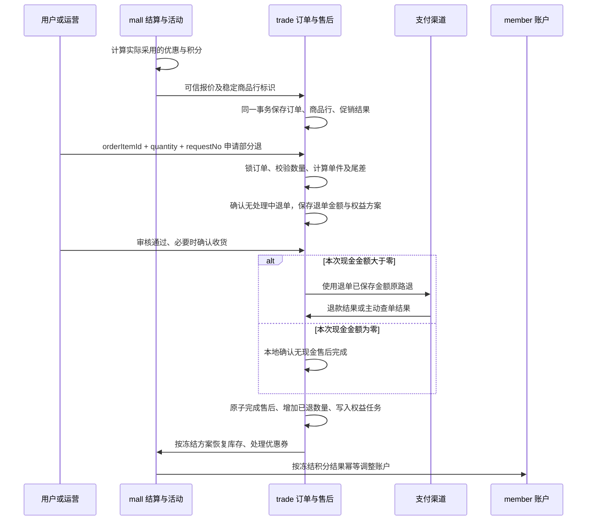

# 第164批：订单促销快照与商品部分退款设计

2026-11-02，v1，设计基线 `9586287e`。状态：设计完成，业务代码、正式迁移和真实环境验收均未执行。

依据：本轮用户要求——促销结果作为 trade 订单扩展；订单、订单明细和退单保存优惠；商品支持按数量部分退；明细记录已退数量；退款采用“先单件金额，最后补尾差”，**公式在生成退单时执行并保存结果**；同订单最多一笔处理中退单，按退单已有order_no查询，**不保存退款中数量**。文档中的后续实施步骤不是本轮已执行事项。使用 cs-design 的15章结构，沿用现有批次目录；仓库未提供其项目根模板和引用的工程参考文件，不补造历史流程状态。

## 1. 工作流

实施顺序：trade 增量表结构及领域契约 → mall 报价携带优惠结果 → trade 本地事务保存订单、明细和优惠分摊 → 支付前调价同步快照 → 售后创建冻结退款方案 → 支付及权益任务 → 管理端、小程序展示 → 历史核对与灰度切换。

业务流：



## 2. 需求背景

### 2.1 AS-IS：代码核对结果

| 当前事实 | 当前源码依据 |
|---|---|
| 售后已有 `orderItemId + quantity`，可多次按数量申请；创建时锁订单并排除重复请求 | [AfterSaleService.java:L91](/Users/wangxx/demo/lemnt-cloud/lemnt-server/lemnt-trade/lemnt-trade-application/src/main/java/com/lemnt/trade/application/aftersale/service/AfterSaleService.java:91) |
| 当前金额为“剩余额度 × 本次数量 ÷ 剩余数量”，每次重新向下取整，不是本轮指定的固定单件基准 | [AfterSaleService.java:L119](/Users/wangxx/demo/lemnt-cloud/lemnt-server/lemnt-trade/lemnt-trade-application/src/main/java/com/lemnt/trade/application/aftersale/service/AfterSaleService.java:119) |
| 已申请且未释放的售后参与额度占用；已有order_no和active_order_no唯一索引，但商品行退单未完整维护后者，不能宣称已限制单笔处理中 | [AfterSaleService.java:L51](/Users/wangxx/demo/lemnt-cloud/lemnt-server/lemnt-trade/lemnt-trade-application/src/main/java/com/lemnt/trade/application/aftersale/service/AfterSaleService.java:51)、[AfterSaleGatewayImpl.java:L66](/Users/wangxx/demo/lemnt-cloud/lemnt-server/lemnt-trade/lemnt-trade-infrastructure/src/main/java/com/lemnt/trade/infrastructure/aftersale/gateway/AfterSaleGatewayImpl.java:66) |
| 现金订单按累计现金退完判断整单 REFUNDED；零元分支已有逐商品数量判断 | [PaymentRefundService.java:L117](/Users/wangxx/demo/lemnt-cloud/lemnt-server/lemnt-trade/lemnt-trade-application/src/main/java/com/lemnt/trade/application/paymentrefund/service/PaymentRefundService.java:117)、[同文件:L191](/Users/wangxx/demo/lemnt-cloud/lemnt-server/lemnt-trade/lemnt-trade-application/src/main/java/com/lemnt/trade/application/paymentrefund/service/PaymentRefundService.java:191) |
| 商品行 `payAmount` 已含分摊运费；包邮路径直接取零运费，未保存原始应收运费 | [SettlementDeliveryService.java:L56](/Users/wangxx/demo/lemnt-cloud/lemnt-server/lemnt-mall/lemnt-mall-application/src/main/java/com/lemnt/mall/application/settlement/service/SettlementDeliveryService.java:56) |
| mall 三张促销订单表还承担请求幂等、活动库存及退款去重，不能只改表名前缀跨库搬走 | [PromotionOrderService.java:L82](/Users/wangxx/demo/lemnt-cloud/lemnt-server/lemnt-mall/lemnt-mall-application/src/main/java/com/lemnt/mall/application/promotion/service/PromotionOrderService.java:82)、[同文件:L168](/Users/wangxx/demo/lemnt-cloud/lemnt-server/lemnt-mall/lemnt-mall-application/src/main/java/com/lemnt/mall/application/promotion/service/PromotionOrderService.java:168) |
| 支付单生成后已禁止调价；当前调价主要修改总应付和行应付 | [OrderAdjustmentService.java:L37](/Users/wangxx/demo/lemnt-cloud/lemnt-server/lemnt-trade/lemnt-trade-application/src/main/java/com/lemnt/trade/application/order/service/OrderAdjustmentService.java:37) |
| 已有持久化支付/退款通知任务，可复用重试及日志机制 | [PayNotifyDispatcher.java:L24](/Users/wangxx/demo/lemnt-cloud/lemnt-server/lemnt-trade/lemnt-trade-application/src/main/java/com/lemnt/trade/application/payment/service/PayNotifyDispatcher.java:24) |

### 2.2 TO-BE 与目标

1. 新订单优惠汇总、行分摊与退款归因全部可从 trade 本地快照查询；查询不依赖活动当前配置。
2. 部分退按固定单件基准生成退单，最后一次结清剩余金额；累计现金退款精确到分且不超过原行实付。
3. 明细直接展示已退数量，处理中信息从当前退单读取；同订单最多一笔处理中，不额外持久化处理中数量，重复回调不重复累加。
4. 售后创建后的金额和权益方案保持不变；渠道失败、消息重复和服务重启均不重新定价。
5. 现金、优惠归因、积分、库存分别对账；现金成功不等于下游权益全部处理成功。

## 3. 需求范围

### 3.1 本次设计覆盖

- S1：订单及商品行的金额、优惠、积分结果快照，支付前调价边界。
- S2：trade 三张促销结果扩展表；mall 保留活动执行职责。
- S3：同一订单明细按数量多次部分退，单笔处理中限制、成功计数、单件基准、末次尾差。
- S4：退单生成时冻结现金、优惠归因和积分结果；本地事务与跨服务幂等任务。
- S5：历史数据可证明迁移、展示接口、实施顺序和验收用例。

### 3.2 本轮不实施

设计阶段不直接修改业务代码或执行DDL；用户随后调用cs-generate后的实施结果见第164批交付报告。不扩展换货、多次并行售后、任意金额退款、拆支付或新的积分负债产品，这些都不是当前要求。保留“一张退单对应一个订单明细”，采用用户确定的“同订单最多一张处理中售后”；一次退多个不同商品由多个顺序售后完成，不假装已有批量退单接口。

## 4. 需求分析与业务规则

### 4.1 金额口径与冻结边界

数据库及现有 API 金额继续使用元和 `DECIMAL(19,2)` / `BigDecimal`；内部拆分用整数分或精确十进制，不使用浮点。所有报价计算只采用实际生效的优惠；会员价与活动价若取最优，只记录胜出的优惠，不能重复累计。

每个商品行：

`pay_amount = line_amount - discount_amount + delivery_original_price - delivery_discount_price + adjustment_amount`

- `line_amount`：下单时商品行原价，保留现有字段；不能用当前商品价回填。
- `discount_amount`：商品优惠总金额，包含活动、券及确实抵扣现金的积分优惠。
- `delivery_price = delivery_original_price - delivery_discount_price`：沿用现有净运费字段。
- `adjustment_amount`：人工调价差额，有符号，正数加价、负数减价，不能伪装成促销。
- `use_point / give_point`：积分数量，与金额分开。积分兑换消耗的积分不自动再折算一笔现金优惠；仅真正按兑换率抵现金的 `POINT_DEDUCT` 记金额，防止重复优惠。

订单汇总均等于商品行求和。金额优惠最多抵到相应基数，净运费和最终应付不得为负。赠券数量沿用现有订单快照，促销头保存其来源分解；不能把赠券面值当现金优惠。

支付单生成前可调价：保留原优惠结果，将应付变化记入调价差额；与支付创建共用订单锁和“无支付记录”校验。普通支付赠积分如需随应付变化，只使用报价时保存的赠送系数更新，不读取新配置；固定活动赠送保持原规则。快照版本同步递增。支付单一旦生成，金额与权益快照冻结。

### 4.2 已退数量与同订单单笔处理中限制

`trade_order_item` 只增加 `refunded_quantity`，含义为已成功完成退款的数量。新订单显式写0；历史不能确认时保持NULL，核对后再写确定值。约束 `0 <= refunded_quantity <= quantity`。不持久化处理中数量，也不新增可退款数量字段。

`trade_after_sale` 已有order_no：创建退单必须在同一事务中先锁原订单，再按order_no查询状态为REQUESTED、AWAITING_RETURN、RETURNED、WAIT_REFUND、REFUNDING的退单。有则拒绝新的申请，同requestNo则幂等返回；没有才允许计算、保存退单。所有管理端、会员端及内部入口共用这条流程，不能只在页面先查询一次。订单锁串行化并发创建；查询沿用现有(order_no,request_no)索引的order_no前缀，不另加重复索引。

无处理中退单时，`可申请数量 = quantity - refunded_quantity`；已有处理中退单时，整订单暂不能新建退单，接口可申请数量返回0。展示处理中数量时读取当前退单的quantity，不再维护一份计数。退款失败及渠道结果未知仍为REFUNDING，继续阻止新申请。

已有active_order_no唯一键可作为辅助防线：创建和状态更新统一维护所有类型售后的活动标记，结束后清空；不新增替代字段或第二套锁。商品行原先未维护标记的路径需补齐，但业务判断直接查询order_no及状态。多笔历史处理中退单先排空或核对，不能为了回填标记擅自取消。

售后单是业务事实，明细已退计数在售后首次进入REFUNDED的同一事务更新。锁顺序为订单→明细→售后；先CAS状态成功，再增加已退数量；重复回调不再增加。取消/拒绝不修改已退数量。库存或积分任务失败不会撤回已确认的现金退款或数量事实。

| 当前售后状态 | 事件 | 新状态 | 数量变化 |
|---|---|---|---|
| 无 | 创建申请 | REQUESTED | 已退数量不变，后续新申请被状态查询阻止 |
| REQUESTED | 同意 | WAIT_REFUND 或 AWAITING_RETURN | 无 |
| REQUESTED / 允许取消的状态 | 拒绝或取消 | REJECTED / CANCELLED | 已退数量不变，可重新申请 |
| RETURNED | 拒收 | RETURN_REJECTED | 已退数量不变，可重新申请 |
| WAIT_REFUND | 发起退款 | REFUNDING | 无 |
| REFUNDING | 明确失败或结果未知 | REFUNDING | 无，继续阻止新申请 |
| REFUNDING | 渠道成功或合法的零现金完成 | REFUNDED | 已退 +q |
| REFUNDED | 重复通知 | REFUNDED | 无 |

允许取消的具体状态沿用当前业务校验，不因本次设计扩大。现金订单与零元订单统一按**所有行数量退完**决定订单 REFUNDED，并校验现金退款合计与应退现金一致；部分退保留原 PAID/SHIPPED/COMPLETED。另行展示派生售后进度，不新增订单主状态 `PART_REFUNDED`。

### 4.3 生成退单时计算：固定单件基准，末次结清

对当前订单明细，定义：

- `Q`：原购买数量；`P`：冻结的原行实付，含现有分摊运费。
- `q`：本次申请数量；`R`：历次成功退款数量；`M`：历次成功退款金额。
- 前提：锁订单后，按order_no确认无处理中退单；同requestNo先幂等返回原退单。
- `U = floor(P / Q, 2)`：固定单件现金基准，每次从原行快照推导，不能用剩余金额重新求单价。

```text
校验 1 <= q <= Q - R
如果 q < Q - R：本次 amount = U × q
如果 q = Q - R：本次 amount = P - M
```

**以上计算只在生成退单的本地事务中执行一次，结果写入 `trade_after_sale.amount`。不需要给订单明细另加“退款单价”列。** 同时写入本次优惠归因、应返积分及应回收赠送积分。审核、执行、渠道查单、通知和失败重试只读取该退单方案，禁止按当前剩余数量、商品价、活动价或会员配置重新计算。

例：原行实付10.00元、购买6件，单件基准1.66元：

| 申请顺序 | 本次数量 | 本次现金退款 | 累计成功退款 |
|---|---:|---:|---:|
| 1 | 2 | 3.32 | 3.32 |
| 2 | 3 | 4.98 | 8.30 |
| 3（退完） | 1 | 1.70 | 10.00 |

第一次申请直接退6件时金额10.00元。最后一次退2件时，金额为剩余3.36元，尾差不要求拆成独立退款行。拒绝或取消的退单不计入 R、M，重新申请使用新的 requestNo；同 requestNo 内容不同必须拒绝。

P很小时 U可能为0。比如0.01元买3件，前两件按数量退的现金是0，最后一件退0.01元；允许合法零现金商品售后，不能强制合并数量，否则不满足部分退要求。零现金方案不调用支付渠道，不伪造现金或 POINT 退款流水；使用本地售后完成事务和权益任务。既有零元 POINT 退款记录继续兼容查询。

### 4.4 优惠、积分和运费

优惠是退款归因，**不是额外退给用户的现金**。某行原价100元、优惠20元、实付80元，购买2件退1件：现金40元、优惠归因10元，不能退50元。每项货币优惠也采用其冻结行分摊额的固定单件基准，最后一次补齐其剩余归因尾差。

积分保留既有累计比例语义，以免借现金规则改变积分政策：`本次应返积分 = floor(行使用积分 × (R+q) / Q) - floor(行使用积分 × R / Q)`。在**创建退单时**计算并冻结，mall 不再对新版方案独立算积分。若一行使用积分来自多项优惠，以该行计算结果为准，再按各来源未返余额以稳定顺序分配、末项补余且不得超过来源余额；不得逐来源二次取整后造成头行不一致。赠送积分回收同样依据冻结的行赠送结果和规则版本计算，账户是否执行成功以 member 流水为准。与现金“固定单件、末次尾差”明确分开。

各分量独立按其规则收尾，不用“本次优惠归因”反推本次现金；允许分量因舍入产生不同单件分布，全部退完后各分量分别与原快照相等。

本版沿用现有行实付包含运费的退款口径，不引入“发货后运费不退”、部分退后补收邮费或满减失效重算。包邮原始运费需要报价时先算应收、再算减免；历史未存的原始运费保持未知。

### 4.5 风险与处置

1. 直接跨库迁移 mall 表 → 活动库存恢复失去本地事务 → 迁移交易结果，mall 保留执行记录与本地去重。
2. 同 SKU 多行用 SKU 关联 → 分摊或退款串行 → trade 一律使用 order_item_id；SKU只用于库存目标。
3. 现金退完但零现金商品未退 → 订单提前结束、库存/积分遗漏 → 使用所有行数量及金额双重核对。
4. 退款成功后任务未落库 → 永久漏退积分/库存 → 完成售后与入任务同一数据库事务，任务执行放提交后。
5. 部分退后重新跑满减 → 历史金额漂移 → 只使用冻结方案，不追溯重算促销门槛。
6. 旧退款只有整单金额或只有SKU → 无法可靠分配到商品行 → 标记历史不完整、隔离核对，不猜测行号或积分。

## 5. 架构设计

| 模块 | 权威职责 | 数据与依赖 |
|---|---|---|
| mall | 活动规则、报价、活动资格、普通/活动库存、券使用及赠券、拼团砍价参与 | 输出实际生效的计算结果；保留本地库存执行去重 |
| trade | 订单金额、优惠结果、行分摊、退款方案、数量额度、现金退款与任务 | 三张新扩展表及订单/售后快照；查询只读本库 |
| member | 积分、经验等账户真实增减和流水 | 接受明确业务号及冻结增减量，自身幂等 |
| 支付模块/渠道 | 原支付与原路现金退款 | 每张退单唯一退款关联；查单解决超时歧义 |

`trade_order_promotion` 一单多条已采用优惠；`trade_order_item_promotion` 一条优惠对多商品行分摊；`trade_order_promotion_refund` 一次售后对原商品行优惠的回退归因。退单现金总额保存在售后/支付退款事实，不复制进每个优惠行，避免一张退单多项优惠导致重复汇总现金。

遵循项目 CQRS 六层：Adapter Req/Res → Application Cmd/Qry、Executor、Service → Domain 模型/Gateway → Infrastructure GatewayImpl、Mapper/DO。RPC、缓存和任务实现不泄漏到领域；不新增跨库外键或跨服务数据库事务。

## 6. API设计

### 6.1 现有部分售后入口

保留 `POST /trade/admin/orders/{orderNo}/after-sales`，权限 `trade:after-sale:create`；会员为 `POST /trade/app/orders/{orderNo}/after-sales`，校验登录及订单归属。保持原 `R` 包装与已有响应字段，新增退款分解使用下述子资源，不破坏历史返回结构。

| 参数 | 位置/类型 | 必填 | 规则 |
|---|---|---|---|
| orderNo | path/string | 是 | 原订单号，最长40 |
| requestNo | body/string | 是 | 最长64，同请求内容重放 |
| orderItemId | body/long | 是 | 必须属于当前订单 |
| quantity | body/int | 是 | 1至999且不超过剩余额度 |
| type | body/string | 是 | REFUND_ONLY / RETURN_REFUND |
| reason | body/string | 是 | 最长500 |

```json
{
  "requestNo": "refund-item-001",
  "orderItemId": 101,
  "quantity": 2,
  "type": "REFUND_ONLY",
  "reason": "退回其中两件"
}
```

不增加让客户端填写金额、优惠或积分的字段；创建响应中的 `amount` 就是本次冻结金额，其余现有字段沿用 [售后接口文档](/Users/wangxx/demo/lemnt-cloud/docs/after-sale-log-api.md)。客户端收到未知结果时先按同 requestNo 重试，不能换请求号重复申请。

### 6.2 新增订单促销只读子资源

地址：`/trade/admin/orders/{orderNo}/promotions`、`/trade/app/orders/{orderNo}/promotions`。方式：GET。后台权限 `trade:fulfillment:query`，会员校验本人。唯一入参 `orderNo`（path/string，必填，最长40），无 body/query；请求例 `GET /trade/app/orders/T001/promotions`。

响应参数：`data.orderNo` 订单号；`snapshotStatus` 为 COMPLETE/LEGACY_PARTIAL；`summary` 为冻结订单金额；`promotions[]` 为采用的优惠及 `items[]` 行分摊；所有金额与现有API一致为两位小数字符串，单位元。退款计数不从这个不可变资源返回，沿用售后商品列表展示。

完整成功响应示例（本例一个商品行、两件、优惠20元）：

```json
{
  "code": 200,
  "msg": null,
  "data": {
    "orderNo": "T001",
    "snapshotStatus": "COMPLETE",
    "summary": {
      "originalAmount": "100.00",
      "discountAmount": "20.00",
      "deliveryOriginalPrice": "0.00",
      "deliveryDiscountPrice": "0.00",
      "adjustmentAmount": "0.00",
      "payAmount": "80.00"
    },
    "promotions": [
      {
        "promotionType": "COUPON",
        "promotionName": "满100减20",
        "discountAmount": "20.00",
        "deliveryDiscountPrice": "0.00",
        "usePoint": 0,
        "givePoint": 0,
        "giveCouponTemplateCounts": {},
        "items": [
          {
            "orderItemId": "101",
            "discountAmount": "20.00",
            "deliveryDiscountPrice": "0.00",
            "usePoint": 0,
            "givePoint": 0
          }
        ]
      }
    ]
  }
}
```

`summary` 各金额含义见4.1；促销名称是下单快照，不是当前活动名。历史未知字段返回 null、状态 LEGACY_PARTIAL；不能把空数组解释成已证实“无优惠”。已知没有优惠的新订单状态 COMPLETE 且数组为空。Long编号序列化沿用工程规则。

### 6.3 新增退单优惠与权益只读子资源

地址：`/trade/admin/after-sales/{no}/promotions`、`/trade/app/after-sales/{no}/promotions`。方式：GET。后台权限 `trade:after-sale:query`，会员校验原订单及售后归属。`no`（path/string，必填，最长40）是售后业务号RF，不是支付退款单PR；无 body/query。请求例 `GET /trade/app/after-sales/RF001/promotions`。

响应参数：`amount` 本次冻结现金；`discountAmount / deliveryDiscountPrice` 本次优惠归因；`returnUsePoint / deductGivePoint` 冻结应执行积分数；`benefitStatus` 处理状态，不把待执行计为已到账；`promotions[]` 是原优惠来源及本次归因。

```json
{
  "code": 200,
  "msg": null,
  "data": {
    "afterSaleNo": "RF001",
    "orderItemId": "101",
    "quantity": 1,
    "amount": "40.00",
    "discountAmount": "10.00",
    "deliveryDiscountPrice": "0.00",
    "returnUsePoint": 0,
    "deductGivePoint": 0,
    "ruleVersion": 1,
    "snapshotStatus": "COMPLETE",
    "benefitStatus": "NOT_STARTED",
    "promotions": [
      {
        "promotionType": "COUPON",
        "promotionName": "满100减20",
        "discountAmount": "10.00",
        "deliveryDiscountPrice": "0.00",
        "returnUsePoint": 0,
        "deductGivePoint": 0
      }
    ]
  }
}
```

### 6.4 现有售后商品列表与错误约定

现有 GET `/trade/{admin|app}/orders/{orderNo}/after-sale-items` 保持数组形态，只增加 `refundedQuantity`；无处理中退单时 `refundableQuantity = quantity - refundedQuantity`，已有处理中退单时整单各行返回0并由原售后列表展示当前处理单。不增加持久化或DTO专用的退款中数量字段。后台权限继续 `trade:after-sale:query`，会员只查本人。列表仅用于提示，创建时仍加锁查询重验。

上述入口统一沿用当前 `R` 与异常处理，不在本批另引入HTTP状态体系或自造数字错误码。业务失败用工程现有失败码；401/403由现有认证权限层处理。示例省略未使用的rows/total，null字段是否输出沿用现有序列化；实施时用现有HTTP测试核对真实code/msg序列化。

| 情形 | 处理及错误语义 |
|---|---|
| 未登录/无权限 | 现有认证拒绝/权限拒绝 |
| 订单、售后不存在或不属于本人 | 沿用现有不存在/无权访问语义，不泄漏数据 |
| 数量不足、已有处理中售后 | 业务失败，数量不足/已有处理中售后 |
| 同 requestNo 不同内容 | 业务失败，请求编号已用于不同内容 |
| 原金额、计数或历史退款不一致 | 业务失败，需对账；事务回滚 |

## 7. 数据库设计

完整带中文注释的增量结构草案：[已整合，查看最终建表](../../lemnt-server/lemnt-trade/sql/lemnt_trade.sql)。该文件在工作项目录，**不是已发布的迁移文件，也未在数据库执行**。

### 7.1 字段与关系

- `trade_order`：增加原价、商品优惠、原始运费、运费减免、调价差额及快照状态/版本；现有 total_amount、delivery_price、use_point、give_point、赠券映射复用。
- `trade_order_item`：增加商品优惠、原始运费、运费减免、调价差额、行使用/赠送积分、已退数量；line_amount、pay_amount、delivery_price、quantity、specs复用。不增加退款中数量或退款单价字段。
- `trade_after_sale`：复用 amount、quantity、order_item_id、refund_no、request_no；增加本次优惠归因、运费优惠归因、应返积分、应回收赠送积分和规则版本。金额与权益方案创建后不可改写。
- `trade_order_promotion`：一个订单实际采用的一项优惠/权益来源；唯一 `(order_id,promotion_key)`，不能限制一个订单只有一个活动。
- `trade_order_item_promotion`：优惠的商品行分摊；唯一 `(order_promotion_id,order_item_id)`，关联实际明细主键。
- `trade_order_promotion_refund`：一次售后对一个原行优惠的归因；唯一 `(after_sale_id,order_item_promotion_id)`，不重复保存现金退款额或商品数量。

单表非负校验和存在性外键在DB约束；优惠归属订单、售后归属明细、头行汇总一致等跨行关系在订单锁内验证。金额快照不提供删除接口。新增DO按工程规范继承BaseDO，领域模型不带持久化注解。

### 7.2 写入与幂等

报价包含稳定 `quoteLineKey` 和实际生效优惠列表；trade 保存商品行后将 key 映射为真实 order_item_id，再在**同一个本地事务**中保存所有分摊。重复创建比较完整报价指纹、金额、行和优惠内容，同业务号不同内容拒绝；不得后补一半明细。

优惠行金额按实际适用基数分摊到符合条件的商品行，稳定顺序、向下取分、末行补余，并确保每行不超可优惠基数。使用积分、赠积分为整数，分别守恒；整张赠券不可拆成小数。

创建售后事务：锁订单 → 同requestNo幂等查询 → 按order_no查无处理中退单 → 锁明细 → 验证已退计数与成功历史 → 按4.3/4.4计算 → 保存退单及优惠归因 → 提交。审核不重算。退款成功事务：按相同锁顺序锁订单/明细/售后 → CAS售后 → 增加已退数量 → 金额和全行数量核对 → 必要时更新订单状态 → 保存下游任务 → 提交。

### 7.3 存量迁移与切换

1. 先部署可兼容旧订单的trade读写协议，再部署mall新报价；新订单明确写快照版本1，旧记录默认 LEGACY_PARTIAL。
2. mall原三表继续处理旧订单请求去重、活动状态及库存事务；新trade表保存交易结果，不能把相同 financial 字段保留成两个可修改权威源。mall旧字段进入兼容只读阶段，待旧流程排空后再做独立退役批次，不在本轮删除旧表。
3. 按order_no读取跨库数据，离线生成映射清单；只有SKU在原订单内唯一匹配时才绑定order_item_id。重复/缺失匹配隔离，不用名称或当前商品信息猜测。
4. 原优惠来源、原始运费、人工调价、实际退积分不能证明时保持NULL；`line_amount + delivery_price - pay_amount` 只能作为未拆分差额，不能直接断言全部是优惠。
5. 已有明细售后只按REFUNDED汇总已退数量；整单历史售后缺少行依据时保留未知，阻止以未知额度创建新版售后，人工核对后再开放。查询同订单多笔处理中历史记录，先完成排空或业务核对再切换单笔规则及回填已有活动标记，不擅自关闭已有退单。
6. 旧的处理中售后继续使用其已保存amount，不按新公式改价；新公式仅用于切换后新建的、额度已核实的退单。旧成功退款额必须纳入末次余额核对，发现不足或超额即阻断。
7. 暂停相关写入的窗口内校准计数和校验和，记录高水位，再恢复写入；不声称一次跨库SELECT天然一致。上线后逐笔核对头行金额、优惠归因、成功退单、支付退款和积分流水。
8. 回退只回退新入口/代码路由，保留已写快照和退款事实；不得在已支付后重算，也不得清空新表作为回滚。

## 8. 枚举与常量

- 快照状态：COMPLETE、LEGACY_PARTIAL。版本1对应本设计；未知不能默认完整。
- 优惠来源：SECKILL、COMBINATION、BARGAIN、POINT_EXCHANGE、DISCOUNT、REWARD、COUPON、POINT_DEDUCT、MEMBER_LEVEL、ORDER_GIFT。只接入现有来源，不引入新的活动产品；SOURCE_ID含义按类型限定。
- 退款规则版本1：现金与货币优惠固定单件基准、末次尾差；积分累计比例；现有含运费退款口径。历史规则版本NULL表示未记录。
- 权益展示状态：NOT_STARTED、PENDING、SUCCESS、FAILED、UNKNOWN（历史缺证据）。由任务及真实执行证据派生，不另造售后成功状态。
- 复用原订单、售后和支付退款状态；任务增加 AFTER_SALE，bizNo为RF售后号，新流程使用该类型，旧REFUND/PR任务兼容。

## 9. 缓存设计

本次不新增财务缓存或Redis计数。报价缓存只作为提交前临时数据；订单一旦保存，退款只能读trade快照。数量额度和幂等由数据库事务、行锁及唯一键保证，不用Redis分布式锁代替行锁。展示可先直接查询，本轮没有证据要求增加缓存失效链路。

## 10. MQ与可靠任务

复用 `trade_pay_notify_task/log` 的持久化、重试、人工补偿能力。新增 AFTER_SALE 类型，以售后号唯一入任务：现金成功或零现金完成与任务入库必须同一trade事务；提供只入库方法，提交后再尝试执行，禁止在该事务中等待RPC。旧REFUND任务继续按PR单号处理。

完整报价使用TradeOrderClient.createPriced，冻结退款经CheckoutLifecycleClient.refunded(RefundBenefitsBo)及MemberGrowthClient.applyFrozenRefund独立RPC入口传递，旧消费者拒绝而非忽略新字段后回落旧规则。新版任务读取已完成售后及冻结方案，将 orderItemId、skuId、quantity、returnUsePoint、deductGivePoint、ruleVersion 明确传给下游。mall本地库存与执行去重同事务；member按售后号加资产业务类型幂等。补充稳定行标识映射，不能仅凭同SKU猜明细。旧无版本回调走既有兼容逻辑，新版不能在mall重新计算积分。

按至少一次投递设计，不能宣称消息只投一次。重复、乱序、RPC超时后重放都依靠消费业务幂等；后到的任务不得用旧状态覆盖新状态。当前[任务领取Mapper:L17](/Users/wangxx/demo/lemnt-cloud/lemnt-server/lemnt-trade/lemnt-trade-infrastructure/src/main/java/com/lemnt/trade/infrastructure/payment/mapper/PayNotifyTaskMapper.java:17)只增加尝试次数，没有独占领取期限，人工重置还会复用attempt编号：在原机制增加lease_until和单调递增execute_version。领取排除有效租约，成功领取递增版本并持有租约；完成按版本CAS，重置也递增版本，过期版本不能覆盖新任务。租约使用数据库时间、覆盖配置的最长RPC执行预算，过期后允许恢复；仍需要业务幂等，不能把租约当成跨服务事务。新旧任务执行器切换须先停止旧执行器，避免旧代码绕过租约。库存、积分或佣金任一失败不能把整任务记成功，重放时已成功环节去重。

赠券退回沿用原全退规则，部分退款不因本次设计擅自恢复使用券或撤销所有赠券；佣金沿用累计退款回收，零现金数量售后不重复回收现金佣金。积分不足回收等账户失败保留任务及流水证据，进入人工补偿，不能记为已执行或改小冻结方案掩盖失败。

## 11. 安全设计

所有金额和权益由服务端可信报价/冻结方案提供，HTTP不接受客户端指定退款金额。管理权限复用已有订单/售后权限；会员同时校验订单与售后归属。新增查询不返回整份内部rule_snapshot、账号凭据或其他会员信息。跨服务调用遵循现有认证，日志不输出手机号地址和配置密钥。退款记录仅由状态机更新，不能开放通用修改/删除接口。

## 12. 日志与监控

保留现有订单日志、售后日志、任务尝试日志。增加可关联字段 orderNo、orderItemId、afterSaleNo、paymentRefundNo、requestNo、pricingVersion、ruleVersion；记录创建时Q/P/R/M/q、冻结amount及是否末次尾差，便于复算但不记录身份敏感数据。

核对指标：数量越界次数、头行金额不一致、优惠分摊不一致、重复通知被幂等拦截次数、待处理/失败任务数与最老等待时长、现金成功但权益未完成笔数。新快照金额/数量不一致要求为0；任何超额退款为0。失败任务沿用现有重试上限与人工补偿入口，不无界重试，也不虚构已接入监控平台。

## 13. 测试方案

### 单元测试

1. 10.00元/6件，依次退2、3、1件，金额3.32、4.98、1.70；与当前剩余均摊算法形成区分。
2. 直接全退、最后退多件、单价整除、0.01元/3件、0元积分行、人工调价及含运费行；分量守恒且不超额。
3. 同requestNo重放金额不变；不同内容拒绝；失败重试不执行定价函数；规则配置变化不影响已创建退单。
4. 货币优惠末次尾差与积分累计比例分别验证；已知无优惠和历史未知分开。

### 集成测试

1. 使用真实Mapper/XML和MySQL验证订单锁、按order_no查处理中及已有唯一键：不同商品行并发申请也只能创建一张；H2结果不替代目标MySQL证据。
2. 创建/拒绝/取消/拒收不改已退计数，成功恰好增加一次；成功通知重复及事务中断不造成半笔更新；退款失败仍被状态查询阻止新申请。
3. 渠道成功与任务入库原子；提交后进程退出仍可恢复任务；mall/member部分成功后重放不多退积分、不多恢复库存。
4. 同SKU不同订单行不能串联优惠；历史整单退款和缺失分摊不会被错误填0；旧RF/PR/POINT任务兼容。

### E2E验收

1. 会员购买6件，三次部分退并核对后台、小程序、trade售后、渠道退款和库存；最后才整单REFUNDED。
2. 多商品、其中一行零现金/积分：先退完现金行，订单仍保持履约状态；零现金行售后完成后才全退，权益正确。
3. 注入渠道未知结果、重复通知、mall或member不可用；恢复后使用原金额完成、无重复权益，界面区分现金成功与权益处理中。

本轮只做设计及文档静态检查，不引用历史测试数量作为本设计已实现证据。

## 14. 验收标准

| Given | When | Then |
|---|---|---|
| 10.00元/6件且未售后 | 先退2件、再3件、最后1件 | 冻结amount依次3.32/4.98/1.70，总额10.00 |
| 退单已生成 | 审核、配置变更、退款失败重试 | amount及权益方案逐字段不变 |
| 一行已成功退2件、当前退单处理中3件、原购6件 | 查询并新建售后 | 已退2、当前处理单数量3，不持久化处理中数量；整单禁止新申请 |
| 上述处理中申请被取消 | 再次查询/新申请 | 已退仍为2，可申请4件，无现金退款发生 |
| 同订单不同商品行的两个请求同时到达 | 加订单锁后查询及创建 | 只创建一张处理中退单，另一请求被拒绝 |
| 成功退款通知重复10次 | 处理所有通知和任务 | 数量只转移一次，库存和积分各执行一次 |
| 原行0.01元/3件 | 每次申请退1件 | 金额0/0/0.01，不向渠道发0元请求 |
| 现金已退完、另一行数量未退完 | 计算订单状态 | 订单不提前REFUNDED |
| 原价100、优惠20、实付80、数量2 | 退1件 | 退现金40，优惠归因10，不叠加退50 |
| 旧订单无可证明原始运费或优惠来源 | 查询/迁移 | 返回历史不完整，未知保持NULL，无伪造来源 |

## 15. 交付与实现计划

本轮产物：本设计、带注释DDL草案、[实现计划](/Users/wangxx/demo/lemnt-cloud/work-items/member-domain-structure/164-order-promotion-implementation-plan.md)及README索引。未commit，未执行数据库迁移，未宣称开发或联调完成。

后续按实现计划P1至P6推进；每批包含契约、代码、聚焦测试、证据与文档。不需要为了设计另建泛化促销引擎、分布式事务平台或缓存平台。
